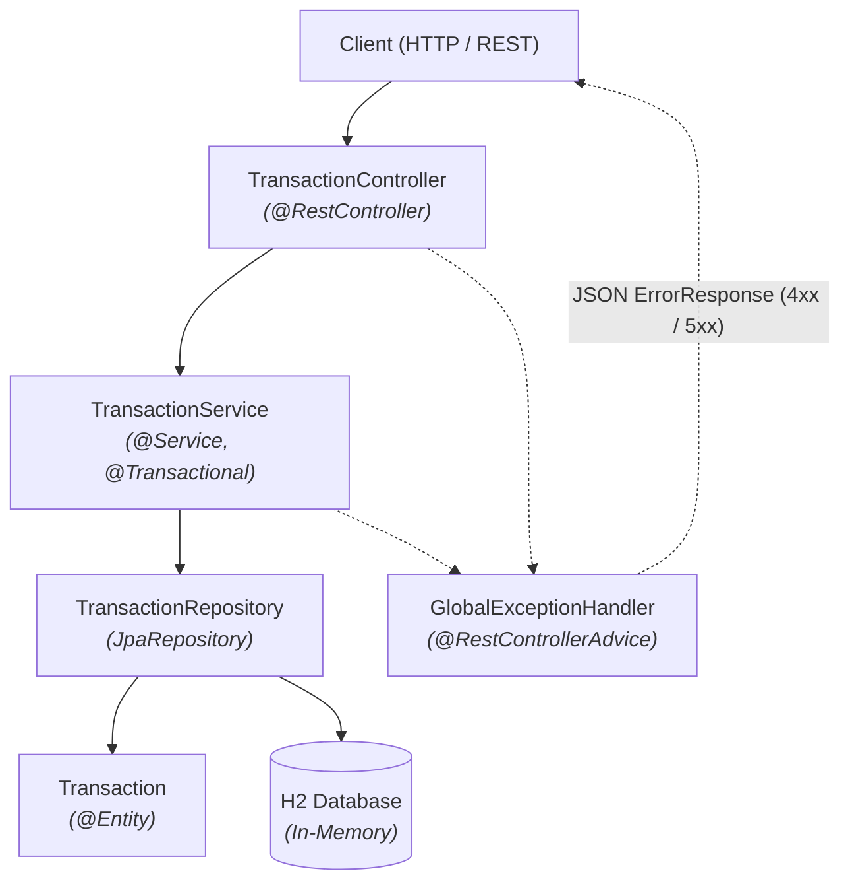
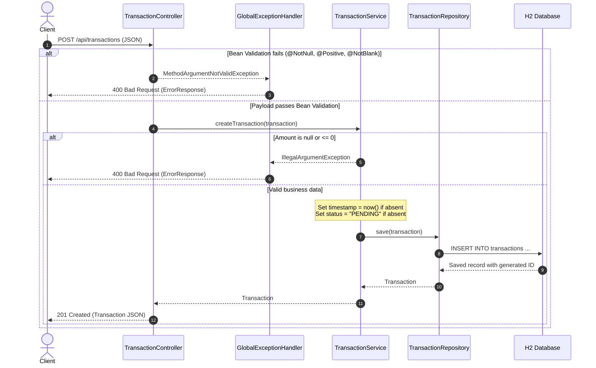

# Application Architecture

## 1. Layered Architecture

The application follows a clean, layered architecture separating presentation, business logic, data access, and persistence. An interceptor handles exceptions across the layers to deliver consistent HTTP error responses.

### Layer Responsibilities

- **Controller (`com.mehdi.payment.controller`)**: Exposes RESTful endpoints, handles HTTP serialization/deserialization, and triggers input validation via `@Valid`.
- **Service (`com.mehdi.payment.service`)**: Encapsulates business logic, transactional boundaries (`@Transactional`), and domain validation rules.
- **Repository (`com.mehdi.payment.repository`)**: Provides Spring Data JPA abstraction for CRUD operations and query execution against the data store.
- **Entity (`com.mehdi.payment.entity`)**: Represents the relational data model mapped to the `transactions` table.
- **GlobalExceptionHandler (`com.mehdi.payment.exception`)**: Centralizes cross-cutting exception interception (`@RestControllerAdvice`), transforming application exceptions into standardized `ErrorResponse` payloads.

---

## 2. Transaction Creation Flow (`POST /api/transactions`)

The diagram below details the end-to-end processing of a transaction creation request, including validation failure paths and successful persistence.

---

## 3. Docker Multi-Stage Build

The container build process uses a multi-stage `Dockerfile` to optimize build performance and keep the final production artifact secure and lightweight:

1. **Build Stage (`maven:3.9-eclipse-temurin-17`)**:
   - Isolates dependencies by copying `pom.xml` first and executing `mvn dependency:go-offline` to leverage Docker layer caching.
   - Copies application source code (`src/`) and packages the artifact using `mvn package -DskipTests`.

2. **Runtime Stage (`eclipse-temurin:17-jre-alpine`)**:
   - Uses a minimal Alpine-based Java Runtime Environment (JRE), discarding build-time tools, Maven dependencies, and source files.
   - Copies only the resulting `payment-transaction-api-0.0.1-SNAPSHOT.jar` as `app.jar`.
   - Exposes port `8080` and defines the container entrypoint (`ENTRYPOINT ["java", "-jar", "app.jar"]`).

---

## 4. CI Pipeline

Continuous Integration is automated using GitHub Actions (`.github/workflows/ci.yml`):

- **Triggers**: Executed on every `push` and `pull_request` targeting the `main` branch.
- **Runner**: Hosted on `ubuntu-latest`.
- **Pipeline Steps**:
  1. **Checkout**: Retrieves project repository source via `actions/checkout@v4`.
  2. **JDK Setup**: Configures Eclipse Temurin JDK 17 using `actions/setup-java@v4` with Maven caching enabled to minimize build execution times.
  3. **Build & Test**: Runs `mvn -B package`, which compiles the codebase, executes all 7 automated tests (unit tests, MockMvc controller tests, and Spring context load tests), and builds the production JAR.
